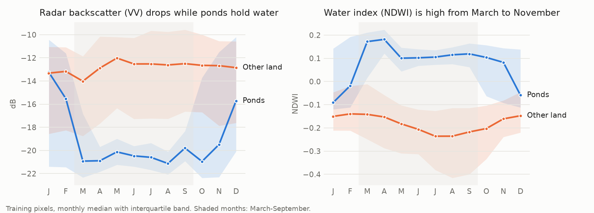

# Finding aquaculture ponds from space when the test year looks different

My solution to the **GeoAI Aquaculture Pond Identification Challenge** (FAO and ITU, on Zindi): decide whether a
10 m x 10 m pixel is a fish or shrimp pond, using monthly Sentinel-1 radar and Sentinel-2 optical data.

I built this after the challenge closed (17 Aug 2026), as a portfolio project. Zindi no longer scores submissions,
so **this solution has no leaderboard score**. All numbers below are my own cross-validation, and I explain
why they are probably optimistic.

## Results

Score = 0.6 x F1 (0/1 predictions at the fixed 0.5 cut-off) + 0.4 x ROC-AUC, as on the leaderboard.

| Version | What it does | CV F1 | CV AUC | CV score |
|---|---|---|---|---|
| baseline | LightGBM trained on full 12-month pixels | 0.863 | 0.965 | 0.904 |
| **v1** | **Trained on pixels masked with real test-set gaps**, season-summary features, 3 seeds | **0.968** | **0.995** | **0.979** |

CV is scored on validation pixels masked to look like test pixels (see below). For reference, the final private
leaderboard had 0.957 for 1st place, 0.945 for 10th and 0.929 for 50th. My CV is higher than any of these, which
tells me the test set is harder than anything I can simulate from the training data, not that v1 would have won.

## Key findings

**1. Test pixels only have part of the year.** Every training pixel has all 12 months. Test pixels have a
4-6 month radar window starting anywhere from January to September, and optical data is missing for extra
months (clouds). A model trained on complete years and scored on test-like windows drops to F1 0.86.

**2. Fix: train on the same gaps.** I copy each training pixel 10 times and blank out months using the exact
missing-month pattern of a randomly chosen test pixel. This uses only the test set's gaps, never labels. It
lifts test-like CV from 0.904 to 0.979, and it doesn't hurt on full-year pixels either (0.985 before, 0.986 after).

**3. Ponds have a clear seasonal signature.** In the training year, radar backscatter over ponds falls from
about -13 dB in January to about -21 dB from March to October (still water reflects the radar away from the
satellite), while the NDWI water index turns positive. In December-February the ponds look drained. Other land
stays near -13 dB with negative NDWI all year.



**4. The test period is very different from the training period.** A classifier can tell masked training
pixels from test pixels with AUC 0.995, even when comparing against training ponds only or non-ponds only.
So the shift isn't just a different share of ponds: the values themselves change (moisture and SWIR indices,
radar VV-VH difference). It is not the Sentinel-2 +1000 processing offset, which is present in both sets. Test
pixels share no values with training pixels or with each other, so there is nothing to stitch together.

**5. The shift changes decisions, and CV can't tell which model is right.** Four feature sets scored between
0.972 and 0.980 in CV, but called 48% to 61% of test pixels ponds (`src/compare_features.py`). I chose the
season-summary features for v1: they are within 0.001 of the best CV, less distinguishable between train and test
(adversarial AUC 0.986 vs 0.995), and more confident on test (19% of predictions between 0.1 and 0.9, against 37%
with all features).

## Approach

1. **Features** (`src/features.py`): for each of the 12 bands and 7 indices (NDVI, NDWI, MNDWI, NDMI, AWEI, radar
   VV-VH and VV+VH), the mean, min, max, median and standard deviation over the months present, plus the mean over
   March-September. Also: how many months are present, the first month with radar data, and the share of months
   that look like water (MNDWI > 0) or dark radar (VV < -18 dB). 121 features. All of them work with any number
   of missing months.
2. **Training on test-like gaps**: 10 masked copies per training pixel, masks copied from real test pixels.
3. **Validation** (`src/cv.py`): stratified 5-fold. Each validation pixel is scored under 6 real test masks, and
   every copy of a pixel stays in the same fold, so nothing leaks between folds.
4. **Model**: LightGBM (15 leaves, 600 rounds, learning rate 0.03), averaged over 3 seeds. No class weighting and
   no threshold tuning: the rules fix the cut-off at 0.5, and the probabilities are left as the model gives them.
5. **Shift check** (`src/adversarial.py`): adversarial validation between masked training pixels and test pixels.

## Trustworthiness

- **Bias:** the training and test pixels come from different periods (and possibly regions). The adversarial
  check shows they are easy to tell apart, so the model's accuracy on new seasons is uncertain. I reduced the risk
  by training on test-like gaps and using summary features, but I couldn't measure the remaining error without
  test labels.
- **Transparency:** by LightGBM gain, the water index NDWI dominates: its maximum over the available months alone
  carries 30% of the model's gain, and its March-September mean another 13%. Mean radar VV backscatter comes next
  (7%). Unexpectedly, the hand-made counts ("how many months look like water or dark radar") rank near the
  bottom: the model gets the same information more precisely from the NDWI and VV statistics.
- **Reusability:** the masking trick works for any pixel-level time-series task where new data has gaps,
  and the features need no fixed calendar window.
- **Efficiency:** training and cross-validation take about 1 minute on a laptop CPU. I did not measure CO2 with
  CodeCarbon; at this scale it is negligible.

## Reproduce

Python 3.13. The competition data is not included: accept the terms on the
[challenge page](https://zindi.world/competitions/geoai-aquaculture-pond-identification-challenge) and put
`Train.csv` and `Test.csv` from the Data tab in `data/`. The data is licensed CC-BY-SA 4.0.

```bash
python3 -m venv .venv && .venv/bin/pip install -r requirements.txt
./run.sh src/cv.py full aug aug_full     # baseline vs training on test-like gaps (about 1 minute)
./run.sh src/adversarial.py              # how different are train and test?
./run.sh src/compare_features.py         # feature sets: CV vs shift vs test pond share (about 2 minutes)
./run.sh src/train_v1.py                 # v1 submission + cv_report.json in submissions/v1/
./run.sh src/plot_signature.py           # figures/seasonal_signature.png
```

`run.sh` runs a script with the project's virtual environment. On macOS without Homebrew's `libomp`, it points
LightGBM at the OpenMP runtime that ships with scikit-learn, so `brew install libomp` is not needed. Everything
uses fixed seeds, so reruns give the same numbers.

## Project structure

```
src/features.py          monthly cube, spectral indices, gap-tolerant summary features
src/cv.py                test-like cross-validation (masked copies, pixel-grouped folds)
src/adversarial.py       train vs test shift check
src/compare_features.py  feature-set comparison behind finding 5
src/train_v1.py          final model and submission
src/plot_signature.py    README figure
submissions/v1/          cv_report.json (the submission CSV itself is git-ignored)
```

## Licence

Code: MIT (see `LICENSE`). Data: CC-BY-SA 4.0, owned by the challenge hosts and not redistributed here.

## Next ideas

- Re-weight training pixels by how test-like they are (from the adversarial model).
- Self-training: add confident test predictions as extra training data, then check if the test pond share is stable.
- Per-pixel normalisation of radar values, to cancel calibration differences between years.
